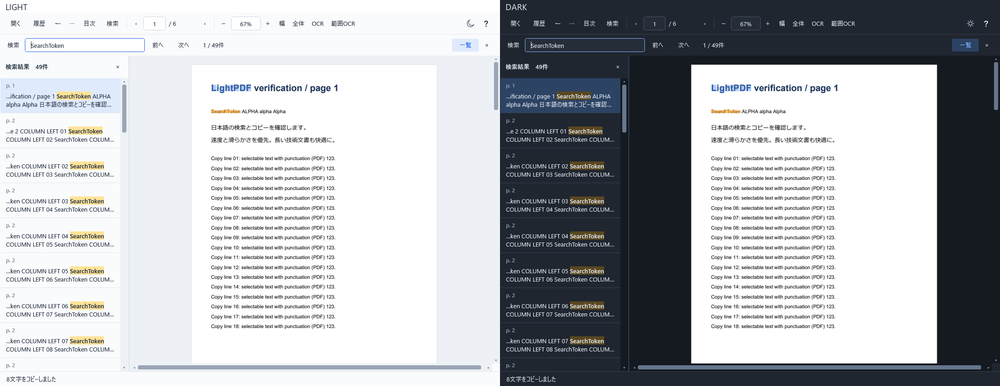
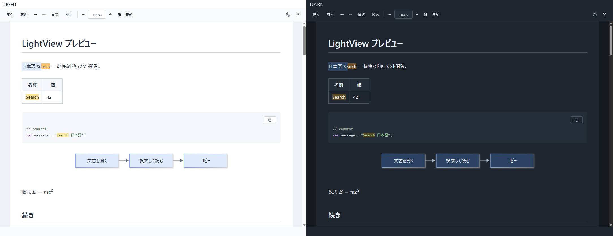

# LightView 📄

Windows向けの、軽快なPDF・Markdown・テキスト・表・HTMLビューワです。

**[ライト／ダーク対応の試作版 0.3.3-design.1 をダウンロード](https://github.com/mezon-web/LightView-Releases/releases/tag/v0.3.3-design.1)**

[安定版 v0.3.2](https://github.com/mezon-web/LightView-Releases/releases/latest)も引き続き入手できます。

## はじめに

1. 試作版のリリースページの **Assets** から `LightView-v0.3.3-design.1-win-x64.zip` をダウンロードします。
2. ZIPを展開し、`LightView` フォルダ内の **LightView.exe** を起動します。
3. 「開く」またはファイルのドラッグ＆ドロップで文書を開きます。

インストーラーはありません。フォルダごと保存して使うポータブル版です。
起動フォルダには **LightView.exe** と補助フォルダ **_support** だけが入っています。`_support` はEXEと一緒に保存してください。起動時の自己展開は行いません。
使い方は右端の **「？」／F1** または [操作説明](docs/操作説明.md) で確認できます。

## 必要な実行環境

- **Windows x64** と **.NET 10 Desktop Runtime x64**。導入済みなら追加のインストールは不要です。[Microsoft公式ダウンロード](https://dotnet.microsoft.com/ja-jp/download/dotnet/10.0) の「.NET デスクトップ ランタイム」から取得できます。
- **Markdown・HTMLの表示**にはMicrosoft Edge WebView2 Runtimeが必要です。[Microsoft公式ページ](https://developer.microsoft.com/ja-jp/microsoft-edge/webview2/) から取得できます。未導入の場合はアプリ内で導入先と再試行を案内します。

.NETとWebView2 RuntimeはZIPに同梱していません。PDF・TXT・LOG・CSV・TSV・JSON・XML・INIの利用ではWebView2を起動しません。

## 対応形式と主な機能

| 形式 | 主な機能 |
| --- | --- |
| PDF | 連続スクロール、ページ移動、文字選択・コピー、検索、しおり目次、文書内リンク |
| Markdown | 表、コードの色分け・コピー、ローカル画像、Mermaid、数式、見出し目次 |
| TXT・LOG | 行番号、検索・コピー、大きな文書の仮想化表示、LOGの追記追従 |
| CSV・TSV | 表表示、見出し固定、列幅変更、全セル検索、セルコピー、絞り込み・並べ替え |
| JSON・XML・INI | 色分け、文字コード選択、折り返し、検索・コピー |
| HTML | ローカルの静的HTML、見出し目次、検索・コピー |

全形式でファイル履歴10件、拡大縮小、検索結果の一覧、読書位置の復元、戻る／進むを利用できます。PDF以外は保存時の自動更新とF5更新に対応します。複数の文書は別ウィンドウで開きます。

対応する斜めのテキスト透かしがあるPDFでは「斜め透かしを非表示」を利用できます。Windows標準OCRが利用できる環境では、画像PDFの現在のページや指定範囲を認識して検索・コピーできます。元のPDFファイルは変更しません。

「検索」は「目次」のすぐ右です。表示範囲のボタンは「幅」「全体」です。文書形式に合う操作をツールバーへ表示し、幅に収まらない操作だけ「…」へ移します。ウィンドウを広げるとボタンに戻ります。PDFは画面のピクセルに合わせて描画し、縮小時の余分なぼかしを抑えます。32MiB以上のテキスト・表は行の索引を作り、表示する部分を読み込みます。

試作版では右上の太陽／月でライト／ダークを切り替えられます。設定は再起動後も復元し、PDFの紙面は元の色を保ちます。ツールバーの高さ、文字サイズ、表示できる操作数は維持しています。

Markdown・HTMLの埋め込みスクリプトを実行せず、外部画像を自動取得しません。閲覧専用です。

## 画面

## 更新と確認

アプリを終了し、新しいZIPを展開して配布フォルダを更新してください。ファイル履歴は引き継ぎます。
各リリースにZIPの **SHA-256チェックサム** を添付しています。

試作版はWindows 11の隔離デスクトップで全機能828項目と追加のテーマ検査27項目を確認しました。旧版との表示密度比較は270条件、ZIP展開後の起動は30回、独立した7ウィンドウも確認しています。Windows 10実機では未検証です。
[変更履歴](CHANGELOG.md) / [第三者ソフトウェアの表記](THIRD-PARTY-NOTICES.md)

このリポジトリは配布版と利用者向け文書を管理します。第三者ソフトウェアのライセンスは配布ZIP内の `_support/licenses` フォルダに同梱しています。

リリースに自動表示される「Source code」は、この配布リポジトリの説明書・画像のアーカイブです。アプリ本体のソースコードは含みません。試作版アプリは `LightView-v0.3.3-design.1-win-x64.zip` をダウンロードしてください。
