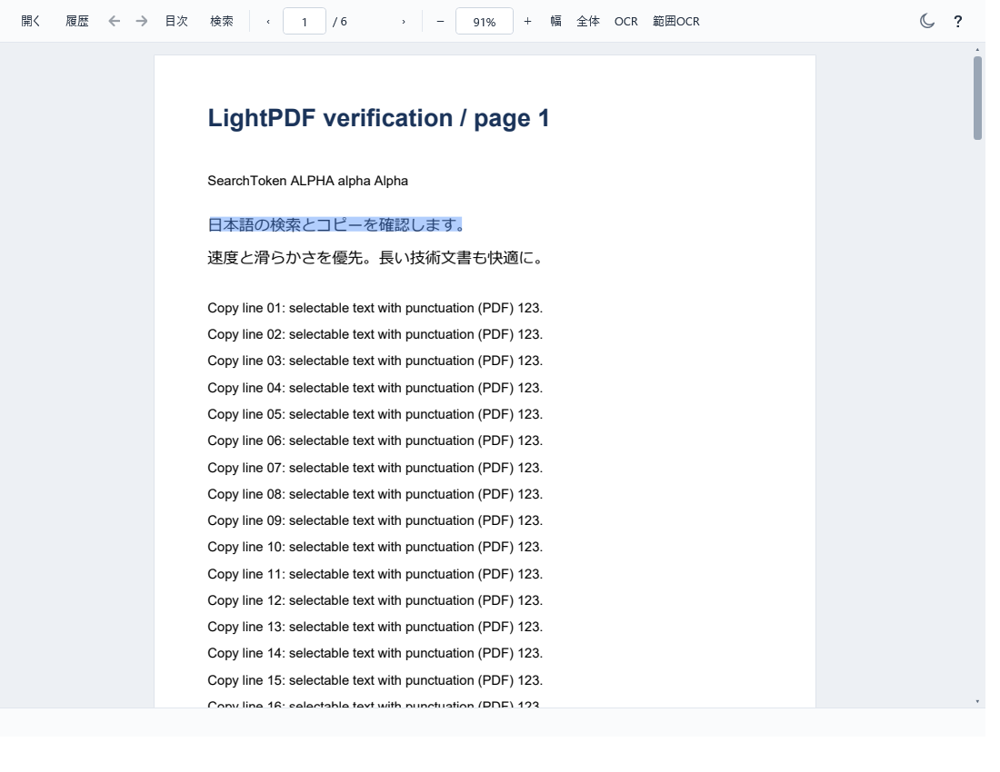

# v0.3.8 PDFの選択表示

2026-10-23。同じ行で選んだ文字を、文字間や単語間も含めたひと続きの帯で表示するようにしました。行の途中だけを選べて、複数行では行ごとに帯が分かれます。コピーする文字範囲は従来どおりです。

英語の空白、日本語の「ー」などの薄い文字でも帯をつなげます。逆方向・回転ページにも対応し、列間や間にある未選択文字は塗らないようにしています。検索強調、単語選択、複数ページの選択は維持します。

## 検査

Windows 11の隔離デスクトップで、配布EXEと同じ発行済みDLLの **770項目** に成功しました。今回追加した21項目では、帯の形だけでなく、部分選択・日本語／英語の完全一致コピー・改行・逆方向・回転・検索強調・OCR・退避した文字情報の再利用を検査しました。旧版で29個だった例の1行は、新版で1個の矩形になりました。

ZIP展開、全10種類の文書を各3回起動、独立7ウィンドウ、UserDataの保持とZIP除外、通常起動時の保存・終了も確認済みです。リモートからダウンロードしたZIPも照合・起動・設定保存を確認しました。
[配布物の検査情報](v0.3.8.json)

既存の行情報を再利用し、常駐cacheや全文配列を追加しません。極端に密なページでの選択追従の長時間測定は未実行です。今回の全体検査ではcached-scrollのframe p95 16.81msで、既存の20ms基準を通過しました。

Windows 10実機、利用者指定52ページ透かしPDFの166項目、実マウスによる手動ドラッグ、すべての混在方向・縦書きPDFは未検証です。EXE＋`_support`、Runtime非同梱、UserData、版付きZIP名とフォルダー構成を維持しています。

最初の全体検査では、選択検査とは別のテーマ再読込の既存検査が1件失敗しました。原因は未確定です。単独検査と全体の再実行では成功しましたが、その問題の解消は断定しません。

ZIP SHA-256: `5585f04cb3a8c13c89a94169c7c2a583c6d58cb3176935d7f66357643fdc4f1a`
